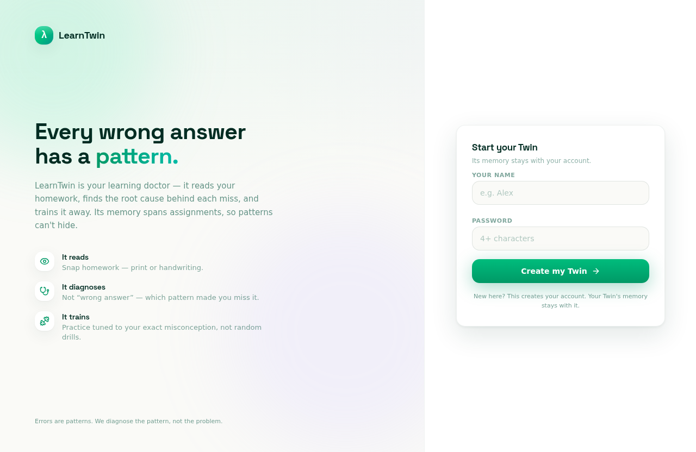
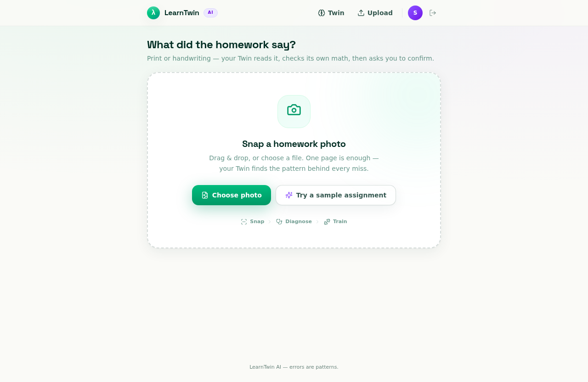
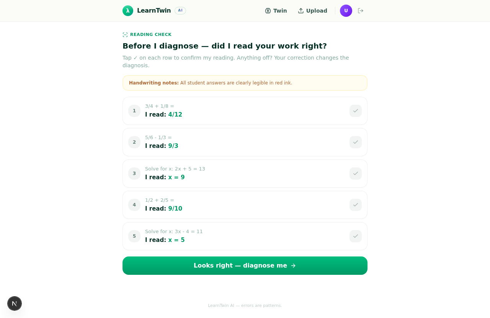
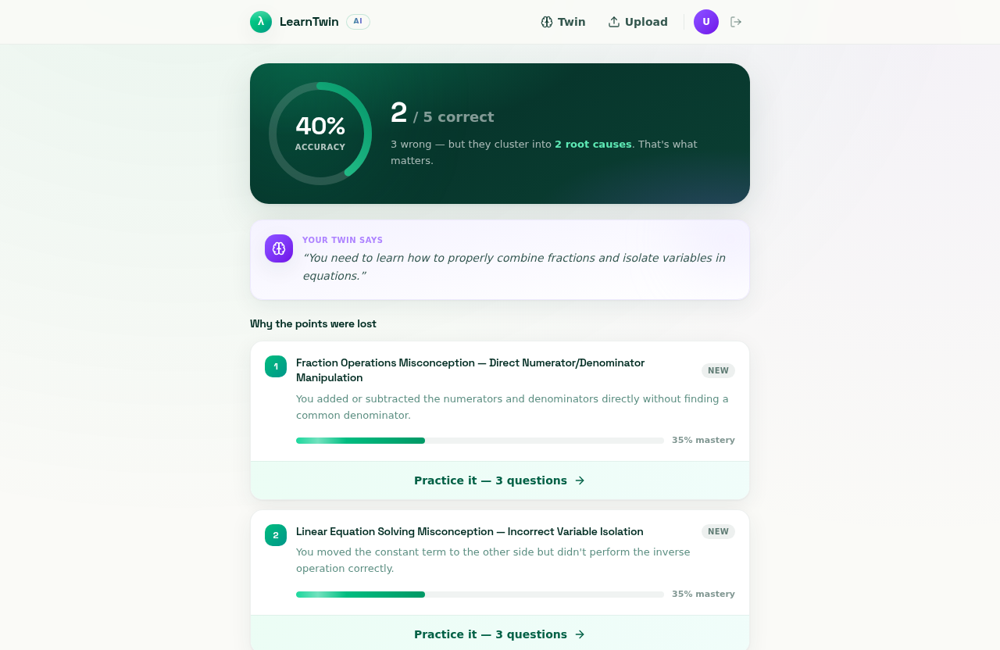
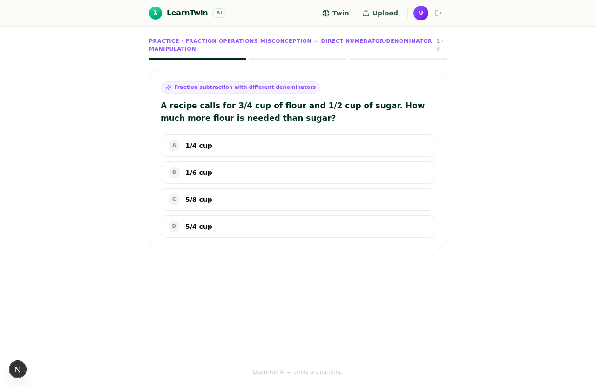
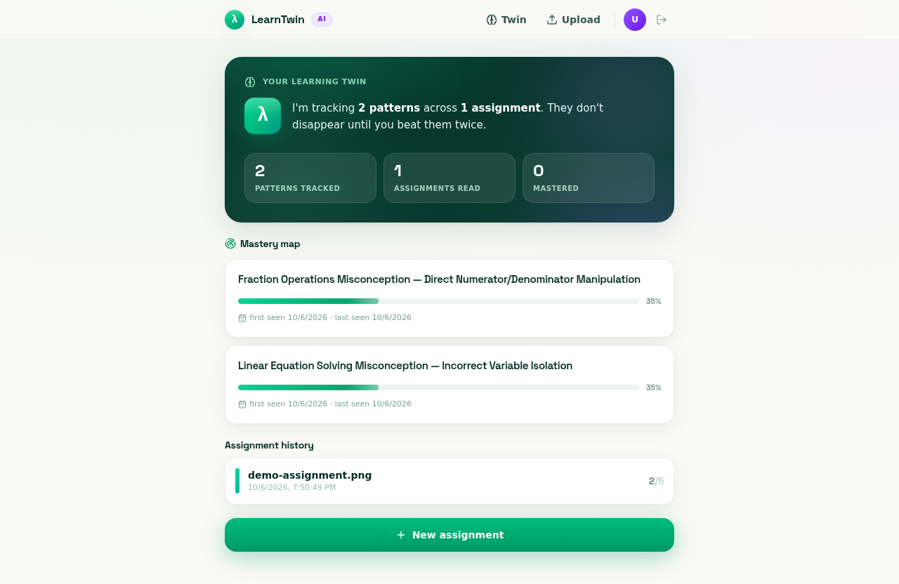

<div align="center">

# λ LearnTwin AI

**Every wrong answer has a pattern.**

Snap a photo of homework. LearnTwin reads it, diagnoses the root causes of mistakes, and trains them away — with a memory that spans assignments.

[Live Demo](https://agentmore.chatglm.cn) · [Screenshots](#screenshots) · [Architecture](#architecture)

</div>

---

## Why

Most homework apps score the page. **Scores are the least interesting part.**

Three wrong answers on fractions aren't three mistakes — they're usually **one misconception** showing up three times. Tutors see this. Parents see this. Apps don't.

LearnTwin is a **learning doctor**, not a grader:

| | Grading app | LearnTwin |
|---|---|---|
| Output | 4/10 | "Confuses LCM with GCF when denominators are coprime — recurring since Oct 4" |
| Memory | Per page | Per student, across assignments |
| Response | Red marks | Diagnosis → targeted practice → mastery tracking |

## Screenshots

| Landing | Upload |
|:---:|:---:|
|  |  |

| Reading confirmation | Diagnosis |
|:---:|:---:|
|  |  |

| Practice | Learning Twin |
|:---:|:---:|
|  |  |

## The hard part: reading homework without fooling itself

A naive pipeline (photo → VLM → grade) fails silently, because **a VLM will follow the student's errors**. If a student forgot to multiply and wrote `2x+3`, the VLM often grades that as *correct* — the error is consistent, so it looks fine. You can't prompt your way out of this.

LearnTwin's answer is **defense in depth** — four independent layers:

1. **Salvage parser** (`src/lib/pipeline/salvage.ts`) — VLM JSON output is assumed broken. A structural salvage layer extracts partial data from malformed responses instead of failing the whole assignment.

2. **Deterministic math verifier** (`src/lib/pipeline/mathVerify.ts`) — every graded problem is re-solved by an independent solver, not by the LLM. The VLM reads; the solver decides. When they disagree, the solver wins.

3. **Practice quality gate** (`src/lib/pipeline/gate.ts`) — generated practice questions are rejected if they contain semantic-equivalent distractors (e.g. `6/9` vs `2/3` as multiple-choice options), non-clean answers, or duplicate correct options. In live testing this gate rejected 4 consecutive bad batches before producing a clean set.

4. **Human confirmation ring** — low-confidence OCR readings (handwritten `4` vs `9`) are flagged amber and shown to the student *before* diagnosis. The student corrects the reading, not the grade.

The result: **0 uncaught silent errors in end-to-end testing**, with a known-weakness list (see Roadmap) instead of unknown ones.

## Architecture

```
photo → upload → [VLM extract + salvage parser]
                  → confirmation ring (amber-flagged low confidence)
                  → [independent math verify] + [diagnose misconceptions]
                  → [practice generation + quality gate]
                  → practice → mastery update
                  → Learning Twin (persists misconceptions across assignments)
```

**Stack:** Next.js 16 (App Router) · TypeScript · Tailwind CSS 4 · Prisma + SQLite · z-ai-web-dev-sdk (VLM + LLM)

**Data model:** `User → Assignment → Problem / Misconception ↔ PracticeItem → PracticeAttempt` — the Twin is the Misconception table keyed by pattern (`key`), so a pattern diagnosed in week 1 recurs in week 5's report with its full history.

## Quick start

```bash
npm install
cp .env.example .env          # or create .env with DATABASE_URL
npm run db:push               # create SQLite schema
npm run dev                   # http://localhost:3000
```

Register with any name + 4-char password. Use **"Try a sample assignment"** on the upload screen for an instant end-to-end run with a built-in demo photo.

## Roadmap

- [ ] Confidence calibration — LLM self-rated read confidence skews high; plan is multi-vote consensus on flagged rows
- [ ] Real-photo regression suite — validated on generated samples; real handwriting (mess, shadow, crumpled paper) needs a broader test bank
- [ ] Practice item human-review sampling
- [ ] Deployed instance (Vercel + managed DB) for the fellowship demo

## License

MIT

---

<div align="center">

*Errors are patterns. We diagnose the pattern, not the problem.*

</div>
